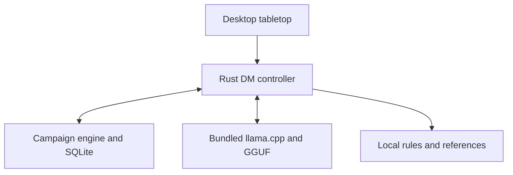

# Offline Dungeon Master: design and packaging decision

Status: proposed architecture and prototype instructions; not an implemented AI integration or a verified offline installer. Reviewed 2026-11-08 against local commit `3c35940` and the current working tree. Existing tabletop edits are outside this change.

Implementation update: an initial native local narrator, saved turn protocol, and Dungeon Master tab are now present in the working tree. See [AI Dungeon Master setup and verification](ai-dungeon-master.md) for the current scope and evidence. The original findings below record the design baseline; complete packaging, mechanical automation, and live-model qualification remain outstanding.

## Product outcome

Deliver a complete Windows package that can be obtained on another computer, copied to the player's machine, installed with networking unavailable, and used for solo Dungeon World AI play immediately. No account, API key, first-launch model download, developer toolchain, or separately installed AI application is required. Optional connectivity must enhance an already working local game.

"Offline" includes installation, first launch, inference, rule lookup, campaign creation, saving, reopening, and recovery. A small installer that downloads its model at first launch does not satisfy this outcome. Downloading the complete package initially is distinct from requiring internet to install or play.

## Environment decision

| Layer | Decision | Reason |
| --- | --- | --- |
| DM development | Keep Unsloth as the local workbench | Compare prompts and models now; evaluate fine-tuning later |
| Player application | Keep the existing Tauri/Rust desktop app | Preserve the tabletop, engine, and save format already in use |
| Inference | Bundle a pinned llama.cpp runtime as an app-managed sidecar | Run a local GGUF without asking the player to install Unsloth, Python, or Ollama |
| Initial model candidate | Qwen3-8B Q4_K_M, already downloaded | A working hardware baseline, not yet a proven best DM model |
| Campaign memory | Rust engine and SQLite, with versioned derived summaries | Model context is temporary; the campaign must survive restarts |
| Rules reference | Bundled SRD and explicit campaign rules profile | Keep source/edition identity separate from generated fiction |

Tauri supports bundled external executables. llama.cpp exposes a local chat API and constrained JSON output. Unsloth can export GGUF; correct chat templates and stop tokens must remain pinned across development and deployment. These capabilities support the proposed architecture; they do not complete the app integration.

## Current repository findings

- `services/ai/src/local_orchestrator.ts` returns `offline-stub` proposals. The modules do not currently run a model.
- `services/ai/src/interfaces.ts` already separates narration, adjudication, encounters, NPC dialogue, and summarization. Keep these responsibilities behind one runtime adapter; do not load five independent models.
- `apps/desktop/src-tauri/src/main.rs` registers campaign/tabletop/rules commands but no AI turn command.
- The Rust engine stores canonical campaign data in SQLite and maintains an event-log mirror. Continue this ownership boundary.
- `apps/desktop/src-tauri/tauri.windows.conf.json` currently selects NSIS only; it does not explicitly bundle an offline WebView2 prerequisite.
- `scripts/offline_policy_check.mjs` rejects HTTP/HTTPS literals except the SVG namespace. A loopback adapter needs a narrowly defined local-transport rule; optional remote integrations must remain separately bounded. Do not remove the guard or permit arbitrary URLs to make inference work.
- The current shared AI proposal interface is only an initial boundary. It does not yet define a complete persisted narrative-turn protocol or a validated mechanical action allowlist.

## Component relationship

The controller assembles bounded context and requests a proposal. The model does not write campaign files or execute arbitrary commands. Validated events return to the existing transactional engine before narration asserts their outcomes.

## First playable turn

1. Load the selected campaign, its explicit rules profile, active scene, party state, known NPC facts, unresolved threads, and latest event sequence.
2. Read a bounded set of recent events and relevant local reference passages. Include only knowledge visible to the current actor in player-facing narration.
3. Send a versioned DM prompt, state snapshot, references, and player intent to the local model.
4. Parse a bounded structured proposal containing player-facing text, a request for a permitted game operation if needed, and proposed narrative-memory updates. This envelope is a design target, not the existing TypeScript interface in full.
5. Validate schema, campaign identity, state revision, entity IDs, allowed operations, and rule support. A JSON grammar helps syntax; it does not establish semantic correctness.
6. For uncertain mechanics, request or perform a real engine roll and retain the resulting event. Require the table's ruling where mechanics are still manual. Never use invented model rolls as canonical results.
7. Apply accepted changes atomically through the engine, then narrate from the committed outcome. Reject or regenerate proposals based on stale state. Do not show draft success as a resolved action.
8. Persist the turn and its event references; update the derived session summary separately. Cancellation or generation failure must leave canonical state intact.

Initial scope: coherent scene narration, NPC conversation, an exploration action, a real dice result where appropriate, and save/reopen continuity. Full automated combat is a separate milestone; the current reference reader and calculators are not a complete combat engine.

## Dungeon Master behavior

The reusable instruction draft is `services/ai/prompts/dungeon-master-v0.1.md`.

- Preserve player agency. Describe situations, consequences, and NPC intent without choosing the player's thoughts or actions.
- Run the campaign's chosen system and edition. Keep house rules explicit; surface unsupported mechanics rather than inventing official rules.
- Maintain consistent names, locations, relationships, time, resources, and knowledge boundaries. New fiction can be proposed; established facts cannot be silently overwritten.
- Show meaningful choices and consequences. Keep ordinary turns concise and stop at the player's next decision.
- Use actual engine outcomes for dice, HP, inventory, conditions, and other mechanical state. Narration may not grant itself write authority.
- Label uncertain rulings. Cite supplied rule references when claiming a published mechanic; never invent a source or page.
- Honor the campaign's tone and boundaries. The player can pause, revise, or override a table ruling without losing their save.

## Memory and context

SQLite remains the source of truth. Persist session turns, important established facts, quest/NPC relationships, and unresolved threads as identifiable records linked to canonical event sequences. Summaries are derived, editable views with a source range and revision, not replacement history. Keep GM-only secrets separate from facts available to players or NPCs.

Start with a measured 8,192-token context on Josh's tested machine. Reserve space for the prompt, selected state/references, and the answer; count tokens before submission. Retrieve relevant material instead of copying every campaign event and rulebook into each turn. Begin with ordinary local text/metadata search; an embedding model is optional and not required for the first offline loop.

Campaign learning means saving/retrieving campaign facts, not retraining the model after every session. Fine-tuning may later improve behavior and formatting; facts such as the party's inventory belong in the database. A saved Unsloth project is not automatically an app feature or a fine-tuned model.

## Inference lifecycle

The Rust controller locates the shipped runtime and model using a versioned manifest, verifies required files, and selects a qualified GPU backend or CPU fallback. GPU drivers remain a platform prerequisite; a fallback must be benchmarked before being promised as playable. Start one app-owned process, bind it to loopback only, and use a per-launch authentication secret. The frontend talks through Tauri commands rather than owning runtime credentials or arbitrary endpoints.

Use a local model path with downloads disabled; pin runtime/model/template hashes, context settings, and generation parameters. Stream only the player-facing response field. Start ordinary narration in non-thinking mode and compare quality/latency before choosing a final default. Load models on demand, support cancellation/timeouts, and stop app-owned processes cleanly. If inference fails, preserve the campaign and allow existing manual tabletop functions to continue.

## Complete package

Ship one offline distribution containing the application installer, runtime and its necessary libraries, model payload, prompt/schema files, offline rules/artwork, prerequisites, licenses, and a checksum/version manifest. The large model may be an adjacent payload in the same archive/media rather than embedded in a single installer executable. Verify the actual installer format's limits and ensure installation imports that payload automatically. "One complete package" does not require one monolithic executable.

On Windows explicitly configure Tauri's WebView2 offline installation option and test on a machine without WebView2. Include or statically link other required native runtimes according to their redistribution terms. Players must not run npm, Cargo, pip, an Unsloth installer, or a model download command. Build separate qualified packages for each supported OS/architecture; Windows verification does not establish Linux compatibility.

Keep writable saves/configuration outside program resources. Store the model once in a resolved application model directory; use `LOCAL_LLM_MODEL_PATH` as the existing explicit override instead of silently adding a conflicting path convention. Preserve `DWA_DATA_DIR` for campaign storage.

### Size and hardware budget

Measured candidate model: **5,027,784,512 bytes** (5.03 GB decimal / about 4.68 GiB), `Qwen3-8B-Q4_K_M.gguf`, local Hugging Face snapshot `a6adef130ffb23ddaf1a62fec9dced968c9bc482`. This is a candidate identity, not a completed release manifest. The current UI public directory contains about 42.6 MB of content; runtime libraries, prerequisites, packaging overhead, and future assets are additional.

Set an initial **under-20-GB installed core-package target**. This is an engineering budget, not a measured installer result or a RAM requirement. Measure download size, installed size, temporary installation space, RAM/VRAM, startup time, and response latency separately. The package must state its qualified hardware range; Josh's RTX 5060 Ti 16-GB system is one test machine, not evidence that every PC will perform identically. Large generative-art or voice models can be optional offline packs later.

## Optional connectivity

The local game starts and continues without a connectivity check or sign-in. Keep future updates, content downloads, remote sessions, and any external model provider behind explicit feature choices and separate adapters. Do not silently send campaign data or switch to a cloud model when local inference is slow. If a requested online feature fails, explain that feature's failure while the local game remains usable. This proposal does not enable any remote provider in the current offline-only AI service.

## Qualification gates

| Gate | Required evidence |
| --- | --- |
| DM behavior | Review agency, continuity, rule grounding, uncertainty, and hidden-information handling using repeatable held-out scenes |
| Engine ownership | Malformed, stale, or unsupported proposals cannot alter state; real rolls and accepted events persist exactly once |
| Memory | Close/reopen preserves the same party, scene, established facts, pending decisions, and rules profile |
| Recovery | Cancelled generation, killed sidecar, missing model, and low memory preserve the last committed save |
| Offline installation | Clean supported Windows profile; no AI apps, model cache, developer tools, or WebView2 already installed; complete package available locally; networking unavailable throughout install and first game |
| Offline play | Create a campaign, narrate, resolve a supported action/roll, save, restart, and continue without remote requests |
| Performance | Record first-token/turn latency and memory on supported GPU and CPU configurations; publish only measured requirements |
| Distribution | Pin component versions/checksums and include component notices; preserve the app's existing AGPL licensing and supplied content attribution |

GSM8K is a math evaluation dataset, not a DM knowledge pack or a complete model. DM qualification needs campaign-specific scenarios. Do not fine-tune on the final held-out evaluation scenes.

### Initial prototype observation

One local Qwen3-8B chat correctly requested an attack roll instead of accepting an automatic kill, withheld confirmed treasure, and acknowledged that it could not save the desktop campaign. It nevertheless invented `1d6 + 4` weapon damage from a generic sword and a supplied `+4` attack bonus. That is a failed missing-stat check, not a complete pass. The prompt was amended to distinguish attack and damage parameters and require a supplied damage expression.

In a fresh chat repeating the same scene, the revised profile no longer invented a damage expression and explicitly rejected the unestablished gold amount. It still made an unsupported statement that saving would end the session and offered to pause to save despite having no connected save operation. Save semantics therefore remain a known prototype limitation. The DM Lab contains both observations; it is not connected to the desktop game's database. These demonstrations are not a DM-quality benchmark or evidence of a finished integration. Runtime validation and held-out scenes remain necessary.

## Implementation order

1. Prototype the DM instructions against the already downloaded model; save good and failed examples.
2. Implement a single local narration adapter and a Rust-owned runtime lifecycle, preserving the current proposal/engine boundary.
3. Add a persistent DM turn/memory protocol and one validated exploration/dice loop. Verify save/reopen and failure recovery.
4. Build and test the complete offline Windows package on a clean machine.
5. Expand reviewed mechanics and only then consider targeted fine-tuning, voice/art packs, and explicit online integrations.

## Primary references checked 2026-11-08

- Tauri 2, **Embedding External Binaries**, `externalBin` and architecture-specific executable naming: https://v2.tauri.app/develop/sidecar/
- Tauri 2, **Windows Installer**, **Offline Installer** and **Fixed Version** sections: https://v2.tauri.app/distribute/windows-installer/
- llama.cpp, **Server README**, chat-completion/structured-output, authentication, and runtime options; pin a release rather than deploying moving `master`: https://github.com/ggml-org/llama.cpp/blob/master/tools/server/README.md
- llama.cpp, **LICENSE** (MIT): https://github.com/ggml-org/llama.cpp/blob/master/LICENSE
- Unsloth, **Saving to GGUF**, including chat-template/stop-token portability: https://unsloth.ai/docs/basics/inference-and-deployment/saving-to-gguf
- Qwen3-8B model card, **Thinking/Non-Thinking Mode**, and Apache-2.0 license identifier: https://huggingface.co/Qwen/Qwen3-8B
- Candidate quantized model and license identifier: https://huggingface.co/unsloth/Qwen3-8B-GGUF
- Existing project decisions: `README.md`, `docs/repository-review.md`, `docs/rules-engine.md`, and `THIRD_PARTY_NOTICES.md`. Retain the current public SRD/importer boundary; importing a private collection is not evidence that every source should ship in the public content pack.
